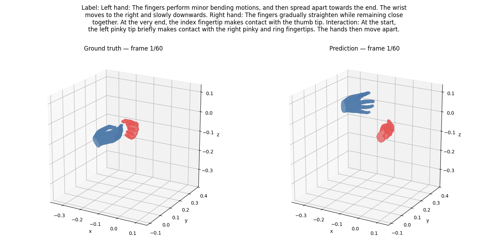
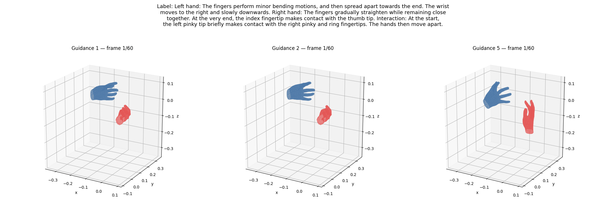

# HandFlow — Project Status

This document tracks the implementation progress, design choices, and current results of the project.

## Repository Structure

- Raw datasets are stored in `datasets/`.
- Preprocessed LMDB datasets are stored in `datasets/preprocessed/`.
- Model checkpoints are stored in `checkpoints/`.
- Figures, GIFs, and other experiment results intended for sharing are stored in `materials/`.
- Data, training, and generation parameters are defined in `configs/`.

## Data

### HandX Dataset 
- format of data with labels

### Completed

- Implemented the HandX preprocessing pipeline from the raw train and test archives to a single LMDB dataset.
- Converted the original MANO axis-angle poses to the HandMDM-compatible 6D rotation representation.
- Implemented the `HandX` PyTorch dataset and `get_handx_loaders()` for the train and test splits.
- Implemented optional temporal right-padding. The loader produces a frame mask, and padded frames are excluded from the training loss.
- Implemented `Mano3DPlot` for MANO mesh reconstruction and dynamic 3D visualization.
- Implemented a notebook for LMDB inspection, loader inspection, and static and dynamic visualization.
- Updated data pipeline. Instead of saving pooled text embedding, we now save tokens (L, d_text) and attention mask.
- loader now returns text embeddings with token and attention masks.


### LMDB Format

The LMDB contains global metadata, dataset statistics, split key lists, and one record per motion sequence.

Each record contains:

- A unique ID, split, source dataset, source key, and sequence length.
- `x` with shape `[T, 198]`.
- A frame mask with shape `[T]`.
- Left and right MANO shape parameters with shape `[T, 10]`.
- Joint positions with shape `[T, 2, 21, 3]`.
- Canonical and paraphrased text annotations for each hand and their interaction.
- Precomputed T5 text embeddings for every text variant.

The 198-dimensional motion representation is organized as:

```text
left translation (3) + left MANO rotations (16 × 6)
+ right translation (3) + right MANO rotations (16 × 6)
```

Text embeddings are produced with `google-t5/t5-small` using attention-mask-aware mean pooling. Motion and text statistics are computed from the training split and stored in the LMDB. Motion normalization is enabled for training, while text embedding normalization is currently disabled.

> must always use statistics computed from the training split.

## Axis 1 — HandMDM Reproduction

### Completed

- Ported the HandMDM transformer denoiser into `models/handmdm/` (verbatim). (27/10/2026)
- Ported the Gaussian diffusion (cosine schedule, 100 steps, x0 prediction, CFG), without Lightning and STMC. (27/10/2026)
- Normalizer accepts statistics as tensors (HandX LMDB) or official stat files. (27/10/2026)
- Ported the CLIP ViT-B/32 text encoder (one 512-dimensional vector per sentence). (27/10/2026)
- Verified against the original code: same checkpoint keys, loss, and samples.

> sampler uses the posterior variance instead of its square root as noise scale (kept for reproduction).
> BOBSL3DT access pending, so Table 2 reproduction is blocked.

### To Do

- Inference script with the official checkpoint.
- Convert SMPL-X 274D outputs to HandX hands and visualize them.
- Set up the HandX evaluator and run HandMDM on the HandX test set.
- Implement the HandMDM trainer and train on HandX.
- BOBSL3DT loader and combined BOBSL3DT + HandX training.

## Axis 2 — Flow-Matching-Based Generation

The objective is text-driven generation of dynamic 3D hand motion using conditional flow matching.

### Completed

- Implemented a temporal 1D U-Net operating on tensors with shape `[B, 198, T]`. (23/10/2026)
- Configured the current model for 60-frame sequences, two temporal stages, 256 base channels, and a 128-dimensional conditioning vector.
- Required the temporal length to be divisible by `2 ** n_stages`; the current 60-frame, two-stage configuration satisfies this constraint.
- Projected the precomputed 512-dimensional T5 embedding into the conditioning space.
- Combined the text and sinusoidal timestep embeddings through an MLP and injected the result into the residual blocks with FiLM conditioning.
- Implemented residual flow matching with linear interpolation:

  $$X_t = (1-t)X_0 + tX_1$$

  and target vector field:

  $$u_t^{\text{target}} = X_1 - X_0$$

- Implemented a frame-masked MSE loss so temporal padding does not contribute to optimization.
- Implemented classifier-free guidance with a conditioning dropout probability of `0.1` during training.
- Implemented ODE generation with 50 Euler integration steps and configurable classifier-free guidance.
- Configured training for 15 epochs with batch size 32, AdamW (`lr=1e-4`, `weight_decay=1e-4`), cosine learning-rate scheduling, and gradient clipping at `1.0`.
- Saved model, optimizer, scheduler, configuration, normalization statistics, metadata, history, and global step in each checkpoint.
- Implemented static and dynamic ground-truth/prediction visualization, GIF export, and guidance-scale comparison.
- Implemented command-line configuration overrides and a SLURM training job.(24/10/2026)
- Updated model with MultiHeadAttention layer in bottleneck + 2 resblocks per stage. (25/10/2026)
- Update the simple linear projection for text embeddings using hidden layer and layer normalization. (25/10/2026)
- add a positional embedding into attention layer at bottleneck level.
- add MotionDiT which is diffusion transformer with AdaLN for timestep and time tokens embeddings. Also uses cross entropy for textual embeddings and fusion for init position.
- updated all pipeline for interface correctness.


### Results So Far

#### Ground Truth vs. Prediction



#### Classifier-Free Guidance Comparison (`1.0`, `2.0`, `5.0`)



### To Do

- Implement quantitative evaluation metrics.
- Evaluate a 64-frame padded configuration with a three-stage U-Net.
- Condition with model with first frame.
- Add regularization for more stable motion (less noisy).
- use manifold and physics losses.
- implement rectified flow matching pipeline with second stage path estimation.

## Axis 3 — VAE with Latent Flow Matching
